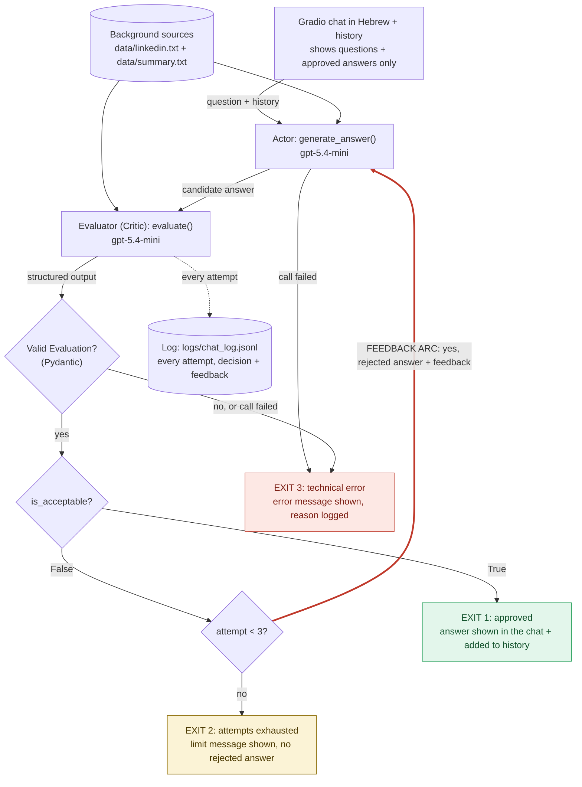

# Personal chat with an answer evaluator – Assignment 1

A Hebrew chat that answers questions about **Naama Yanovsky** (third-year CS student, Tel-Hai College) using only two background files.
For every question, an **Actor** writes a draft answer and an **Evaluator (Critic)** checks it.
Approved answers are shown. Rejected answers go back to the Actor with feedback, up to 3 attempts per question.

The background is my real profile. `data/linkedin.txt` holds my professional details arranged in LinkedIn profile sections (prepared from my CV); `data/summary.txt` is a half-page personal summary in Hebrew. Phone number and email were left out on purpose, because this repository is public.

## How it works



## Requirements

- Python 3.12 (installed by uv)
- [uv](https://docs.astral.sh/uv/) (installs Python and the libraries)
- An OpenAI API key

## Setup

```
git clone <this repository's URL>
cd twin-critic
uv venv --python 3.12
uv pip install -r requirements.txt
cp .env.example .env
```

Then open `.env` and replace `your-key-here` with your OpenAI API key. The key is never committed.

## Run the chat

```
uv run app.py
```

Open the address printed in the terminal (usually http://127.0.0.1:7860).
Every question is written to `logs/chat_log.jsonl`, with all attempts, decisions and feedback.

## Run the tests (the five scenarios)

```
uv run run_scenarios.py
```

It writes `results/llm_scenarios.json` (language-model runs), `results/mock_scenarios.json`
(control-flow tests with a mock evaluator) and `results/summary.md`.

## Models and settings

| Setting | Value |
| --- | --- |
| Actor model | `gpt-5.4-mini` |
| Evaluator model | `gpt-5.4-mini` |
| Max attempts per question | 3 (including the first) |
| Temperature | model default |
| Structured output | Pydantic model `Evaluation` (`is_acceptable: bool`, `feedback: str`) |
| Library versions used | pinned in `requirements.txt` |

## Files

| File | Part | What it does |
| --- | --- | --- |
| `data/linkedin.txt`, `data/summary.txt` | A | The background sources |
| `config.py` | – | Models, attempt limit, loading the key |
| `prompts.py` | A, B | The background text, the Actor's system prompt, the Evaluator's system prompt |
| `actor.py` | A | Writes an answer; on revision receives the rejected answer + feedback |
| `evaluator.py` | B | The `Evaluation` model, the evaluator call and validation, and a mock evaluator |
| `pipeline.py` | C | The generate → evaluate → revise loop, the three exits, and the log |
| `app.py` | A | The Hebrew Gradio chat |
| `run_scenarios.py` | D | Runs the five scenarios and saves their logs |
| `results/`, `screenshots/` | D, E | Scenario logs, summary and screenshots |
| `report.pdf`, `diagram.png`, `diagram.mmd` | E | Short report (Hebrew) and architecture diagram |

## Notes

- Scenario 5 and the extra technical-error test use a mock evaluator (no model call). They are marked `[MOCK]` and saved separately from language-model results.
- No API keys are stored in this repository. `.env.example` contains variable names only.
- Based on lecture 2, slides 19–21 (background + history, structured evaluation, improvement loop).
